# Store on Amazon EKS

  

  <strong>This repository presents the project.</strong> 
  The source code is private and available on request.

DevOps portfolio · Oliver Sims

An eight-service store on Amazon EKS. Terraform owns the platform. GitHub Actions builds images into private ECR. Helm values in Git are the deploy contract. Argo CD reconciles the cluster. A published GitHub Release is the only path that changes what the cluster runs.

The platform was validated end to end, then decommissioned so the account would not keep paying for idle EKS, NAT, and load balancers. Screenshots in this report are from that run. The same stacks recreate from the runbooks in the private repositories.

| Setting | Value |
|---------|-------|
| Region | `us-east-1` |
| Environment | `store-dev` |
| Cluster | `store-dev-store` |
| DNS | `simsoliver.com` |
| Release in evidence | `v1.0.1` |

## Contents

1. [What was built](#what-was-built)
2. [Architecture](#architecture)
3. [Delivery](#delivery)
4. [Infrastructure](#infrastructure)
5. [Security](#security)
6. [Observability](#observability)
7. [Operations](#operations)
8. [Design choices](#design-choices)
9. [Working with AI](#working-with-ai)
10. [Where to read the code](#where-to-read-the-code)

---

## What was built

| Area | What was built |
|------|----------------|
| Infrastructure | Terraform, one stack per concern, remote state in S3. Later stacks read earlier ones with `terraform_remote_state`. |
| Compute | EKS 1.34, three private `t3.large` nodes, Karpenter for overflow. |
| Delivery | GitHub Actions with OIDC to private ECR. CI must pass before an image is published. A GitHub Release opens a pull request that bumps Helm image tags. Argo CD syncs from Git. GitHub Actions never talks to the cluster. |
| Data | DynamoDB for the catalog, Amazon MQ (RabbitMQ) for orders, DocumentDB for completed orders. |
| Edge | Two Application Load Balancers. ACM and Route 53 on `*.simsoliver.com`. WAF on the store load balancer only. |
| Security | Private subnets, Secrets Manager with Secrets Store CSI, EKS Pod Identity, IMDSv2, Pod Security Admission `restricted`, default-deny NetworkPolicy, ResourceQuota, image scanning. |
| Observability | Prometheus, Grafana, Alertmanager to Slack, Fluent Bit to CloudWatch, Beyla traces into Tempo. |
| Operations | Ordered create, check, and destroy scripts for platform, data, and the store. |

---

## Architecture

Application code and platform code live in two private repositories so they can change on different schedules. Argo CD clones only the application repository.

| Repository | Owns |
|------------|------|
| store-app | Service source, Dockerfiles, the shared Helm chart, per-service values, Argo CD applications, GitHub Actions |
| store-platform | Terraform, data stores, ECR and the GitHub OIDC role, cluster add-ons, operator scripts |

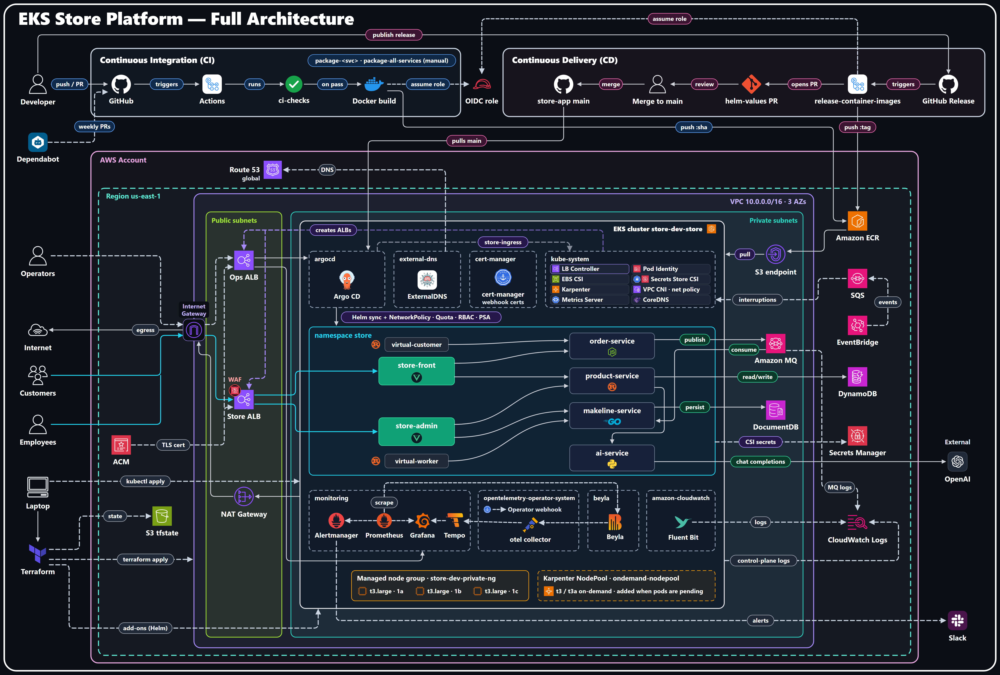

*Platform architecture: CI, the VPC, EKS, data stores, and observability.*

Public subnets hold the internet gateway, NAT gateway, and load balancers. Private subnets hold the nodes and the data stores. The managed node group is the baseline. Karpenter adds nodes when the baseline is full.

Two Application Load Balancers share the edge:

- **Store** (`group.name: store`), with WAF, for `store.simsoliver.com` and `store-admin.simsoliver.com`.
- **Ops**, for Grafana and Argo CD. No WAF on this path.

### Request and data path

TLS terminates at the store load balancer. The storefront calls the catalog and the order API. The admin UI calls the catalog and the makeline worker. Placing an order publishes to Amazon MQ. The makeline worker consumes that queue and writes the completed order to DocumentDB. The catalog is a DynamoDB table. Ask AI goes from the admin UI through the catalog service to a Python service that calls OpenAI. Two simulators stay inside the cluster and have no public URL.

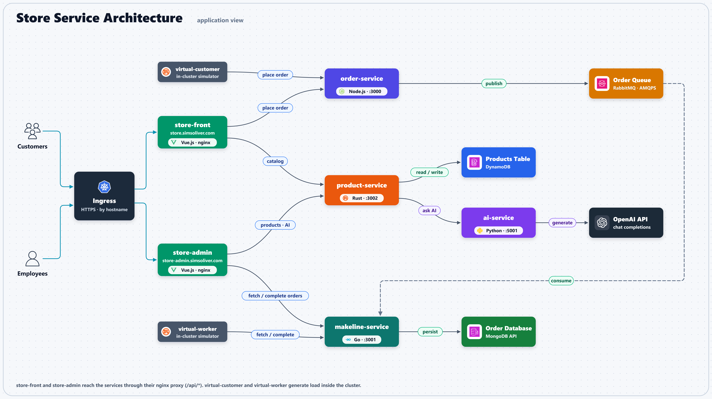

*Service architecture from ingress through the data stores.*

| Service | Language | Port | Role |
|---------|----------|------|------|
| store-front | Vue | 80 → 8080 | Catalog and cart (`store.simsoliver.com`) |
| store-admin | Vue | 80 → 8081 | Products, orders, Ask AI (`store-admin.simsoliver.com`) |
| product-service | Rust | 3002 | Catalog in DynamoDB `store-products` |
| order-service | Node.js | 3000 | Accepts an order and publishes it to Amazon MQ |
| makeline-service | Go | 3001 | Consumes the queue and writes completed orders to DocumentDB |
| ai-service | Python | 5001 | Product copy through OpenAI |
| virtual-customer | Rust | — | Shopper simulator, 20 orders per hour |
| virtual-worker | Rust | — | Worker simulator, 10 orders per hour |

The six workloads behind a Kubernetes Service autoscale from 3 to 6 replicas at 70% CPU. Pods spread across three availability zones (`maxSkew: 1`, `DoNotSchedule`). The simulators run as three fixed replicas and have no Service.

The screenshots below are from the live run over HTTPS. Those hostnames are not served after teardown.

### Storefront

| 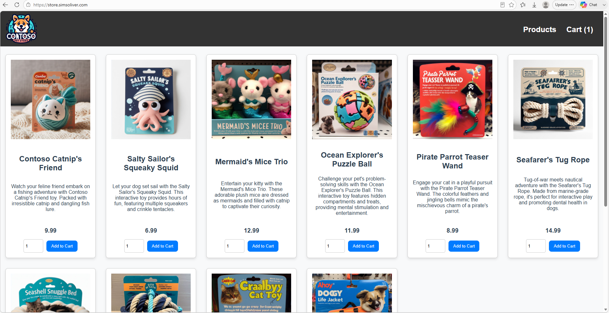 | 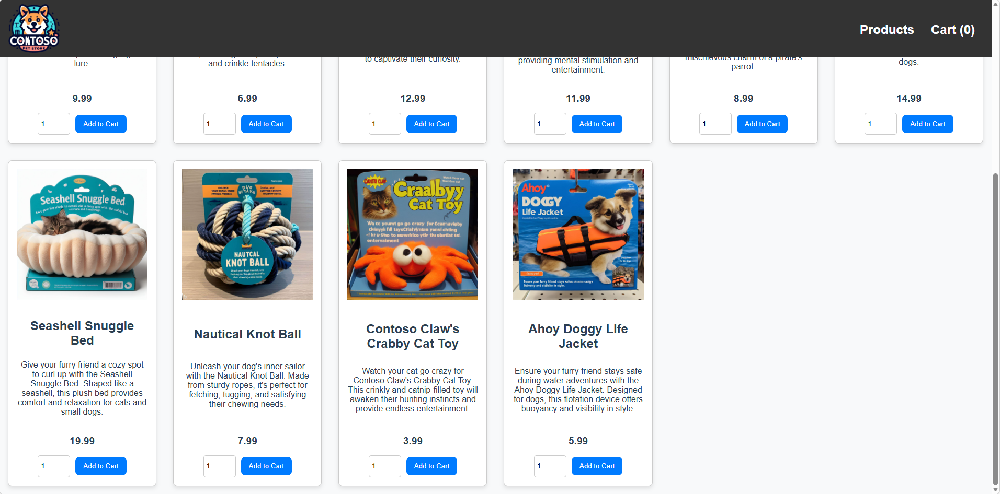 |
|:---:|:---:|
| Storefront catalog | Rest of the catalog |

### Admin

| 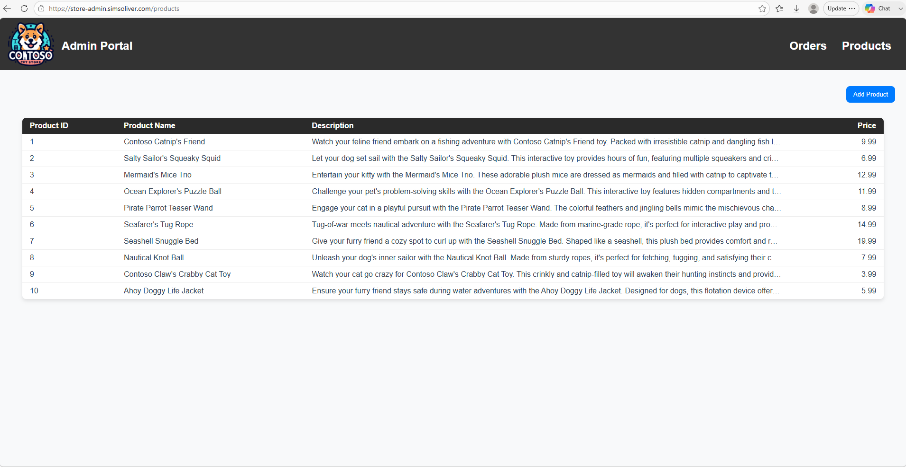 | 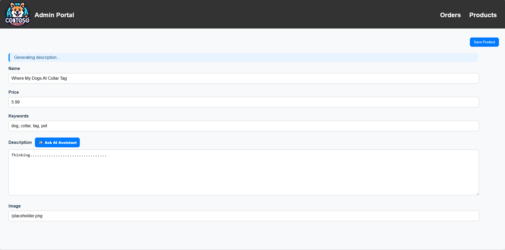 | 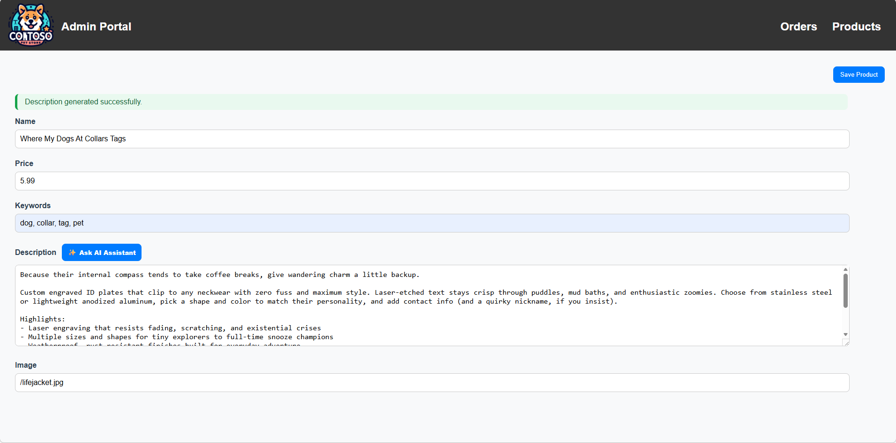 |
|:---:|:---:|:---:|
| Admin product list | Ask AI in progress | Ask AI description written back onto the product form |
| 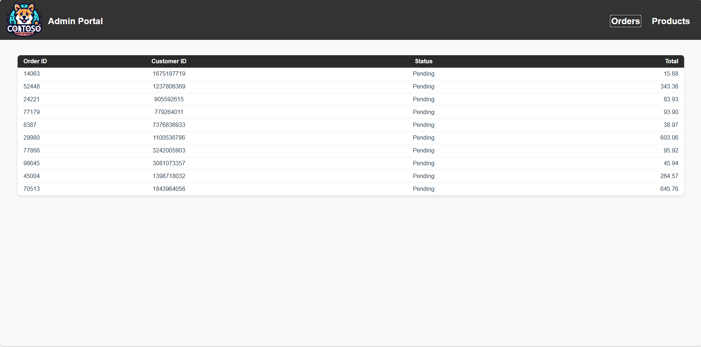 | 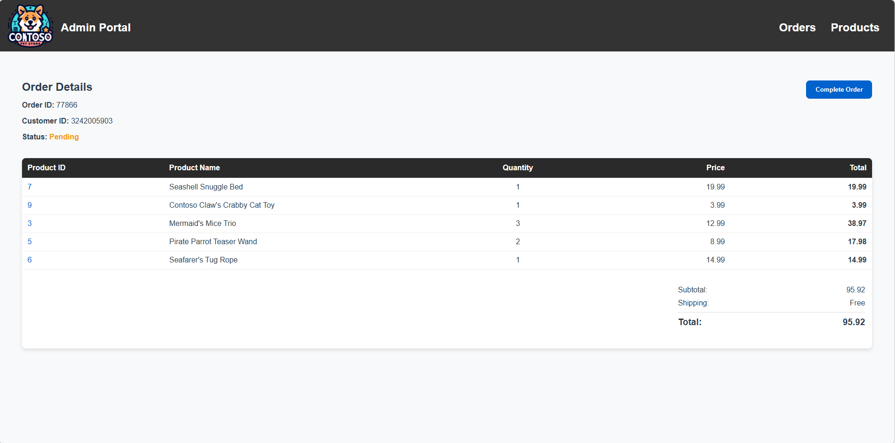 | 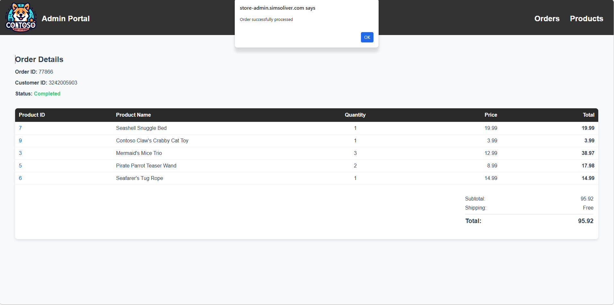 |
| Admin orders, including simulator traffic | Order detail | Order completed |

---

## Delivery

A push to `main` builds the service that changed. A GitHub Release is the only path that changes what the cluster runs. Cluster credentials are not available to GitHub Actions.

### Continuous integration

Workflows live in the application repository. GitHub Actions assumes IAM role `store-dev-github-actions-ecr` through OIDC. The repository does not store an AWS access key.

Every `package-*.yaml` workflow calls `ci-checks.yaml` first. Format, unit tests, secret scanning, and SAST must pass or the image is not published. Dependency audit and Trivy still run and print findings; they do not fail the job, because transitive CVEs change every week. ECR scan-on-push tracks those.

| Workflow | When it runs | What it does |
|----------|----------------|--------------|
| `ci-checks.yaml` | Called by each package workflow | Format and lint, static analysis, unit tests, dependency audit, Gitleaks, Semgrep, Trivy, smoke, Playwright where the UI has it, Syft SBOM. Sequential. |
| `package-<service>.yaml` | Push or pull request under `src/<service>/` | Runs ci-checks, then builds that image. A push to `main` publishes `store/<service>:<7-char-sha>`. A pull request builds and does not push. Helm values are not edited. |
| `package-all-services.yaml` | Manual | Builds all eight SHA tags. Leaves Helm values unchanged. |
| `release-container-images.yaml` | GitHub Release published | Builds all eight images as `store/<service>:<release-tag>`, then opens a pull request that sets `image.repository` and `image.tag` in `helm-values/*.yaml`. |

Release `v1.0.1` published all eight images, then opened the Helm-values pull request. The matrix finished in about ten minutes. Merging that pull request is the deploy. Pull request **#4** changed the eight values files and was merged to `main`. That commit is what Argo CD reconciled.

### Release run and pull request

|  |
|:---:|
| GitHub |

| 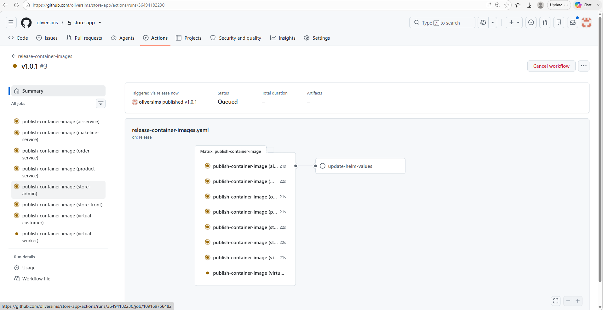 | 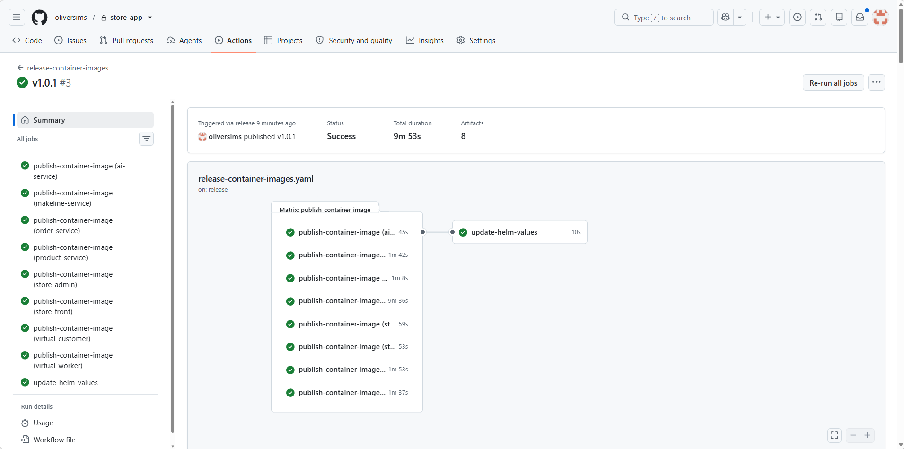 |
|:---:|:---:|
| Release queued | Release v1.0.1: eight images published, then Helm values updated |
| 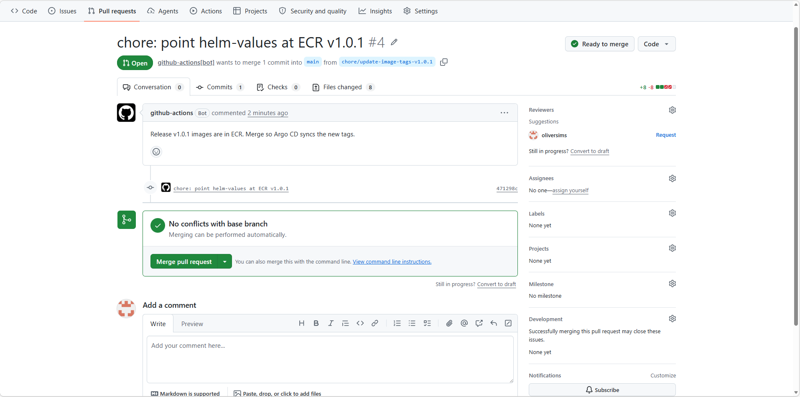 | 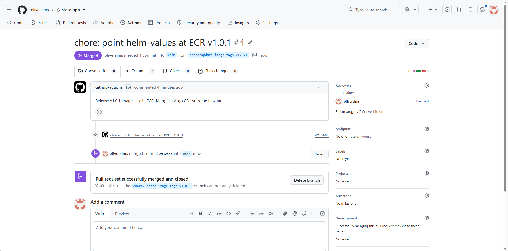 |
| The `github-actions` bot opened the Helm-values pull request | Pull request #4 merged to `main` |

### ECR image tags

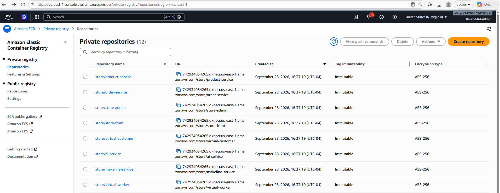

*Private ECR repositories, one per service.*

Tags are immutable. Each repository shows release tag `v1.0.1` and the SHA tags from `main`.

| 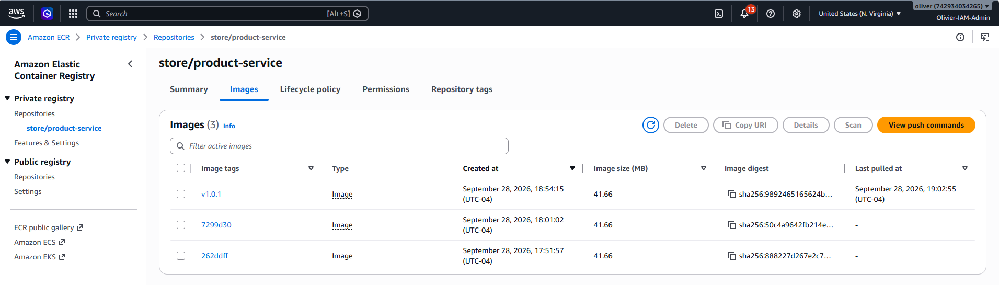 |  |  |  |
|:---:|:---:|:---:|:---:|
| product-service | order-service | store-front | store-admin |
| 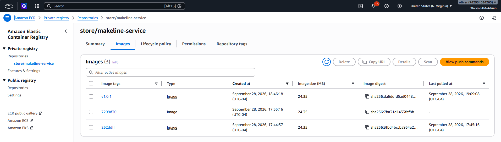 | 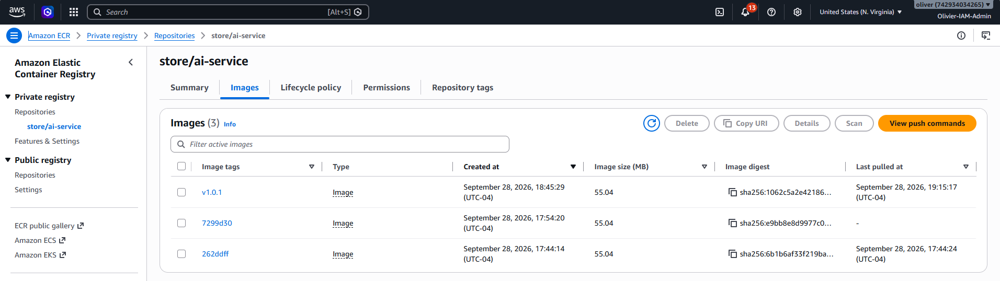 |  |  |
| makeline-service | ai-service | virtual-customer | virtual-worker |

### GitOps

Terraform installs Argo CD (`platform/argocd`) on the ops load balancer at `argocd.simsoliver.com`. Argo CD is installed from Terraform, so it is not one of the applications it syncs. The DNS alias is a Terraform Route 53 record, not ExternalDNS, so a destroy removes it and a recreate does not keep a leftover hostname.

The contract is `argocd/store.yaml` in the application repository:

| Application | Source | Destination |
|-------------|--------|-------------|
| ApplicationSet `store` | Chart `helm/` and `helm-values/<name>.yaml`, revision `HEAD` | One Application per service in namespace `store` |
| `store-policies` | `k8s/policies` | NetworkPolicy, ResourceQuota, RBAC, Pod Security Admission labels |
| `store-ingress` | `k8s/ingress` | Store load balancer Ingress |

Sync is automated, with prune and self-heal. Image tags in Git are the deploy.

| 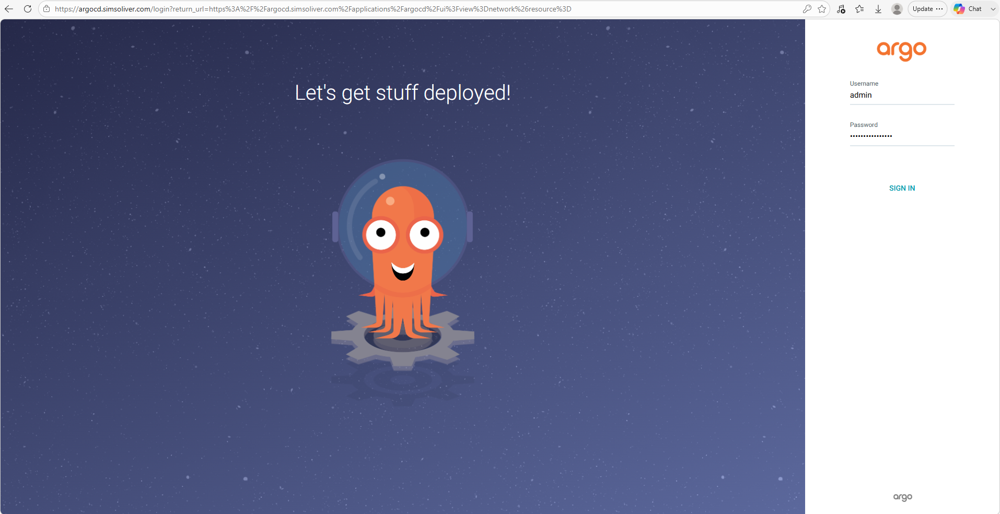 |
|:---:|
| Argo CD sign-in |

| 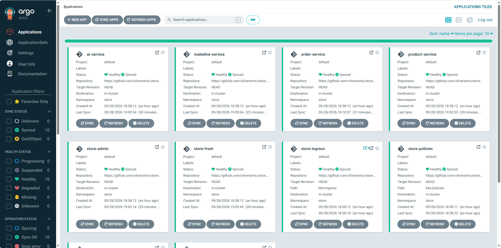 | 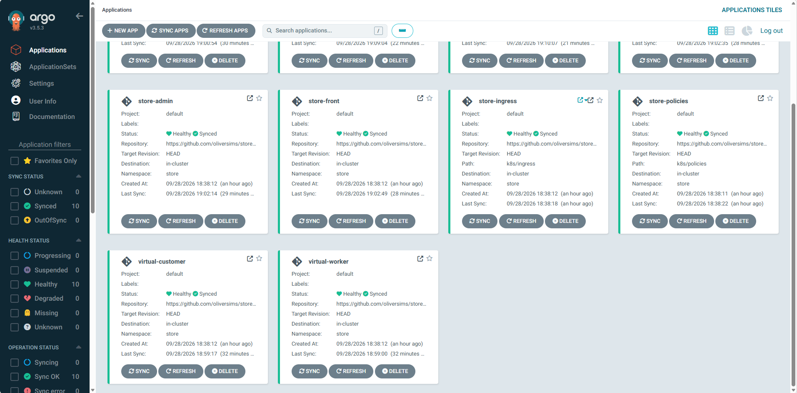 |
|:---:|:---:|
| Store services, ingress, and policies Healthy and Synced | virtual-customer and virtual-worker on the same ApplicationSet |

Ten applications, all Healthy and Synced to the application repository at `HEAD`.

Queue host, queue URI, and the DocumentDB URI are Terraform outputs, pasted into Helm values before the first sync. Usernames and passwords stay in Secrets Manager. Secrets Store CSI mounts them into the pods.

---

## Infrastructure

Each Terraform folder is its own state. Apply order is the dependency order.

**Platform:** `backend` → `vpc` → `acm` → `eks` → `karpenter` → `cert_manager` → `metrics` → `monitoring` → `tempo` → `logging` → `otel` → `argocd`

**Data and delivery identity:** `github_actions_ecr` → `secrets` → `products` → `documentdb` → `mq`

State is versioned in S3. OpenAI and Slack values stay in local files that `.gitignore` excludes.

### Network

- VPC `10.0.0.0/16` across `us-east-1a`, `us-east-1b`, and `us-east-1c`, with public and private `/24` subnets.
- Nodes and data stores have no public addresses. Egress is one NAT gateway.
- An S3 gateway endpoint carries state, image layers, and provider downloads.
- Public ingress is the load balancers on ports 80 and 443.

### Compute and data

- EKS 1.34. API authentication mode `API_AND_CONFIG_MAP`. Control-plane logs (api, audit, authenticator, controllerManager, scheduler) kept for 7 days.
- Managed group `store-dev-private-ng`: 3 × `t3.large` (minimum 1, maximum 6), Amazon Linux 2023, encrypted gp3, IMDSv2 required.
- Karpenter NodePool: on-demand `t3` and `t3a` in the same three zones, consolidate when empty or underutilized, CPU limit 50.
- DynamoDB table `store-products` with point-in-time recovery. Amazon MQ RabbitMQ on AMQPS 5671. DocumentDB cluster `store-dev-orderdb`.

| 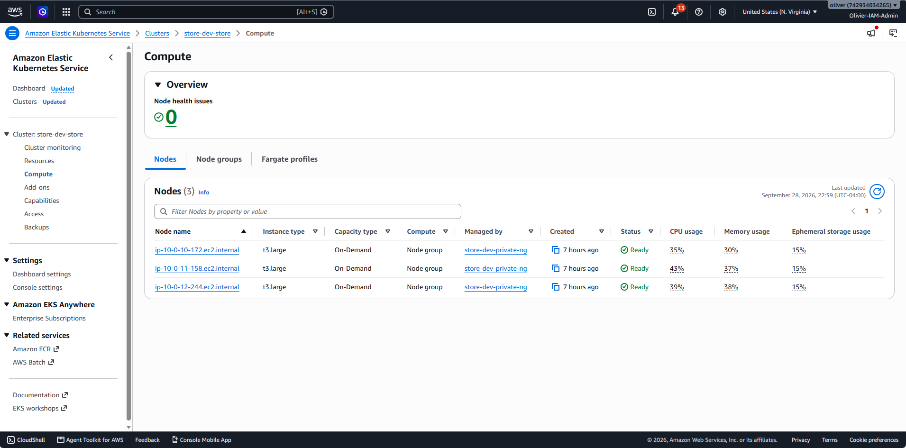 |
|:---:|
| Three t3.large nodes Ready |

| 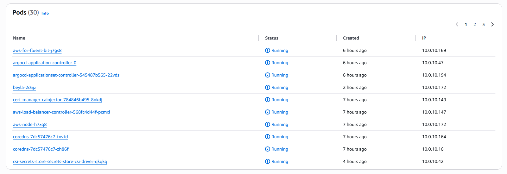 | 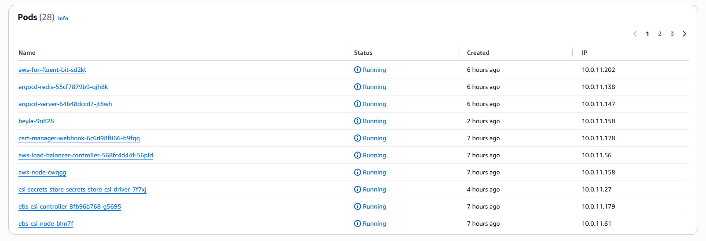 | 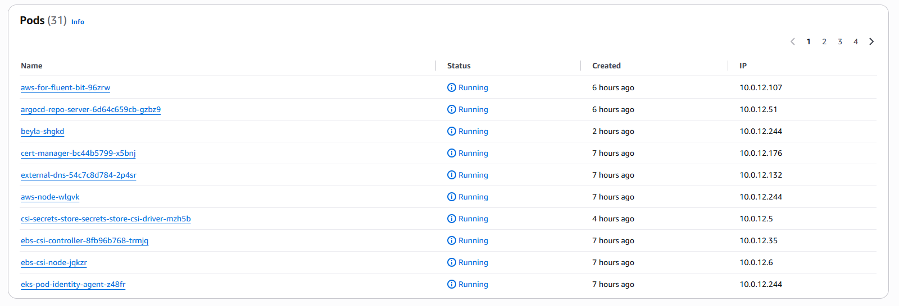 |
|:---:|:---:|:---:|
| Add-ons on the first node | Add-ons on the second node | ExternalDNS, Pod Identity, and EBS CSI |

### S3 remote state

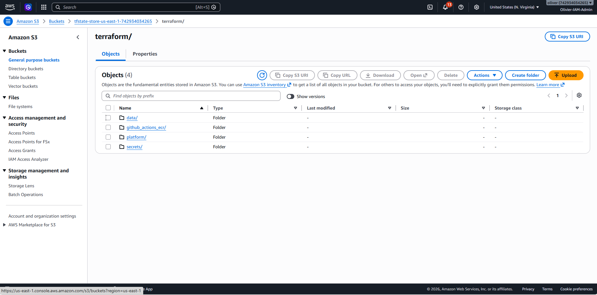

*Remote state prefixes in S3, one key prefix per stack.*

| 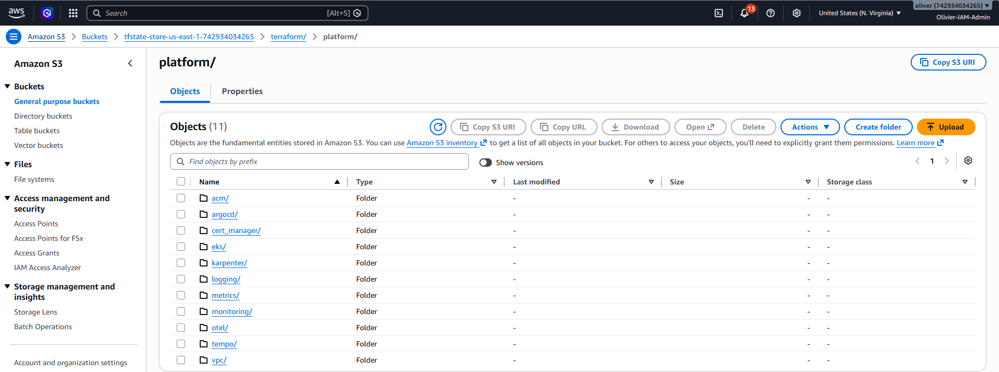 | 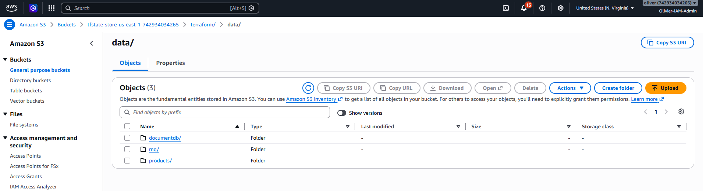 | 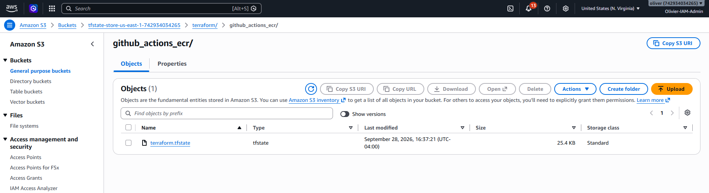 | 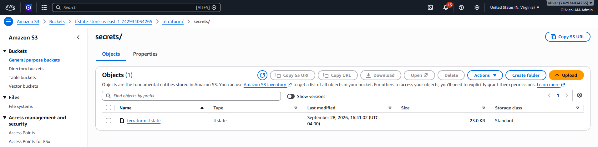 |
|:---:|:---:|:---:|:---:|
| Platform stack keys | Data stores | ECR and OIDC | Secrets Manager state |

### Resilience on this cluster

| Control | Setting |
|---------|---------|
| Horizontal pod autoscaling | 3–6 replicas at 70% CPU on the six served workloads |
| Simulators | 3 replicas each |
| Topology spread | `maxSkew: 1` on zone, `DoNotSchedule` |
| NetworkPolicy | Default deny in `store`. Ingress is per service. Egress is DNS, Pod Identity, HTTPS, Amazon MQ, and DocumentDB where the workload needs them. |
| Quotas | ResourceQuota on `store` |
| WAF | `AWSManagedRulesCommonRuleSet` on the store load balancer |
| Overflow capacity | Karpenter, beside the managed group |

This is one environment. The controls above are the production-shaped baseline that ran on `store-dev`.

---

## Security

These controls were on the cluster during validation, and they remain in the Terraform and the manifests.

| Control | How it is applied |
|---------|-------------------|
| Secrets | AWS Secrets Manager. Secrets Store CSI syncs them into the namespace. Secret files are not in Git. |
| CI identity | GitHub OIDC to `store-dev-github-actions-ecr`. No long-lived key in GitHub. |
| Workload identity | EKS Pod Identity for DynamoDB and for reading secrets. Pods do not carry access keys. Instance metadata `169.254.169.254` is blocked. |
| Pod security | Namespace `store` enforces Pod Security Admission `restricted`. Workloads run as non-root, drop `ALL` capabilities, use `RuntimeDefault` seccomp, and a read-only root filesystem. |
| Network | Private subnets for nodes and data. Default-deny NetworkPolicy in `store`. Who may call whom is in `k8s/policies/network-policy.yaml`. |
| Edge | WAF on the store load balancer. Grafana and Argo CD are on the ops load balancer. |
| Images | Private ECR, immutable tags, scan on push. Untagged images expire after one day. CI runs Gitleaks, Semgrep, and Trivy before a push to ECR. |
| Nodes | IMDSv2 required (`http_tokens = required`). Encrypted EBS. Karpenter hop limit 1. |
| Audit | EKS control-plane logs, including the audit log, retained 7 days. |
| Terraform | Variable files that hold secrets are gitignored. |

---

## Observability

Add-ons are Terraform `helm_release` resources. They are not part of the store ApplicationSet, so an application sync cannot remove Grafana or the log pipeline.

| Signal | Path |
|--------|------|
| Metrics | kube-prometheus-stack, Grafana at `grafana.simsoliver.com` |
| Logs | Fluent Bit to CloudWatch. One group per service, plus the EKS control plane and Amazon MQ. Retention is 7 days. |
| Traces | Grafana Beyla (eBPF) to the OpenTelemetry Collector to Tempo. No tracing SDK in the services. |
| Alerts | Alertmanager to Slack `#devops-alerts` |

Beyla runs in namespace `beyla` and records HTTP in namespace `store`. Storefront `POST /api/orders` traces from live checkout were in the 5–12 ms range. `ai-service` `POST /generate/description` ran about 26–30 seconds, which matches the OpenAI call behind Ask AI.

### Metrics

| 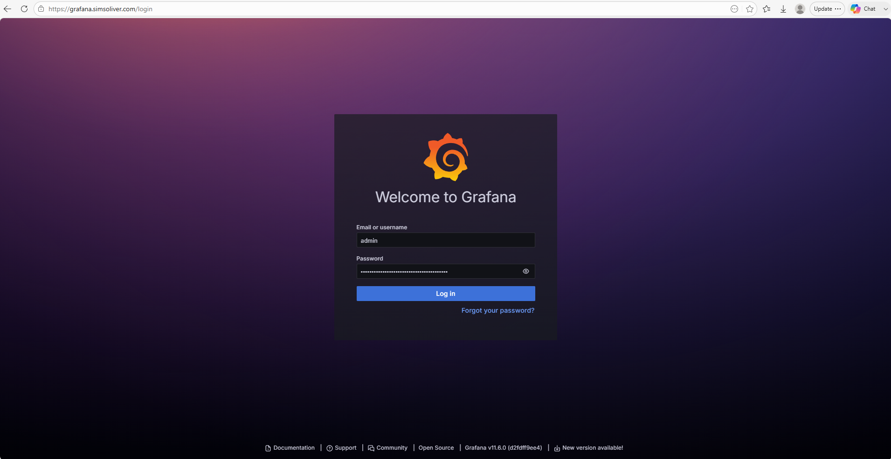 |
|:---:|
| Grafana sign-in |

| 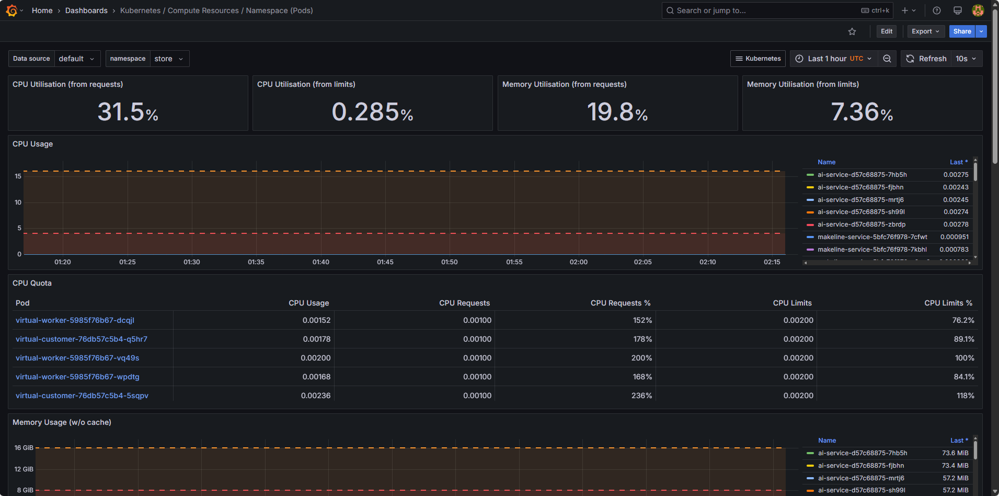 | 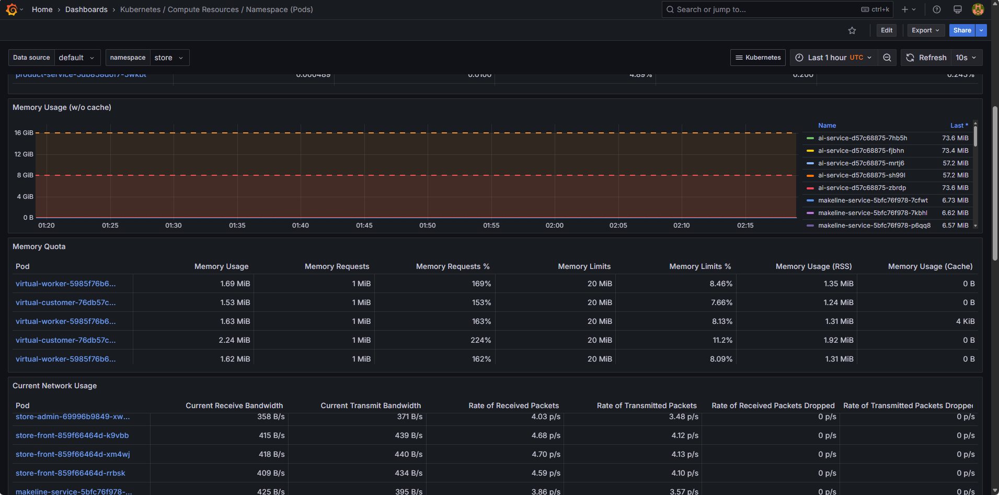 |
|:---:|:---:|
| CPU and memory in namespace store while orders were flowing | Memory and network |
| 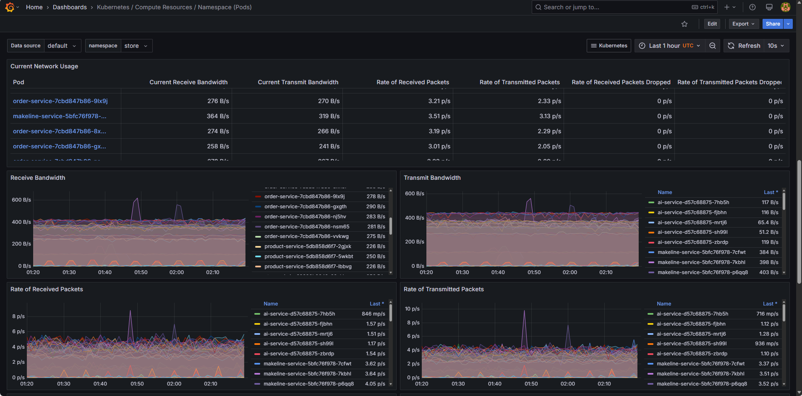 | 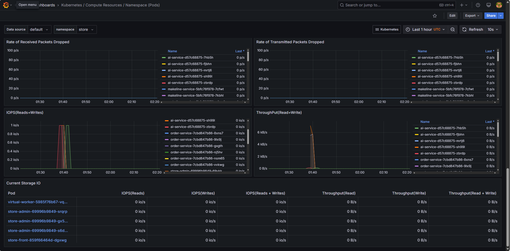 |
| Pod network | Drops and disk IO |

### Logs

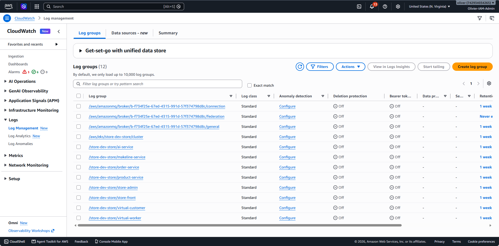

*CloudWatch groups for each service, the control plane, and Amazon MQ.*

| 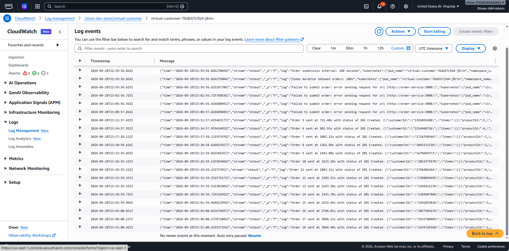 | 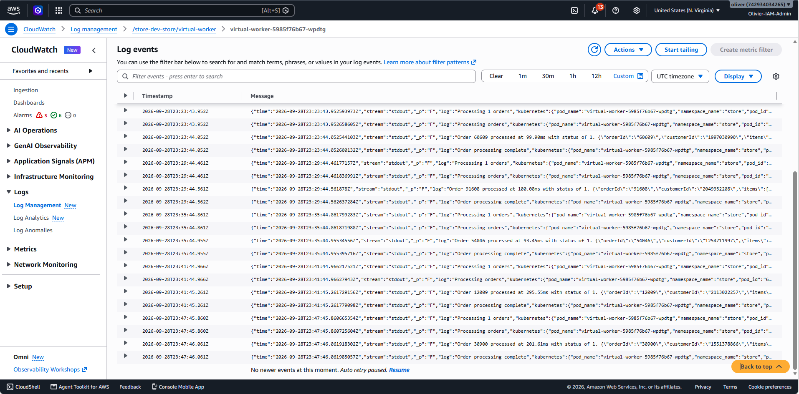 | 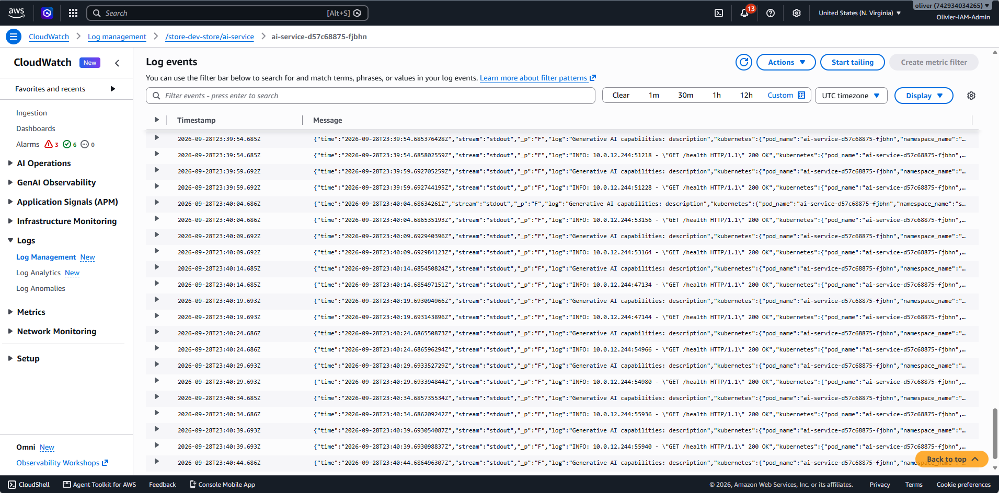 | 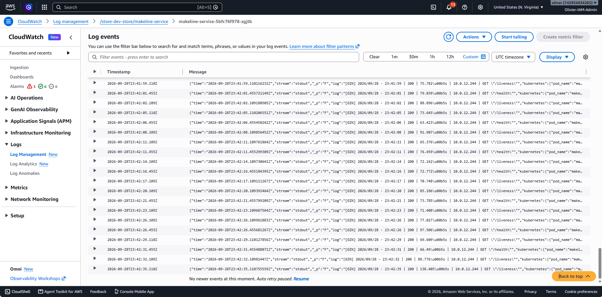 |
|:---:|:---:|:---:|:---:|
| virtual-customer logs | virtual-worker logs | ai-service logs | makeline-service logs |
| 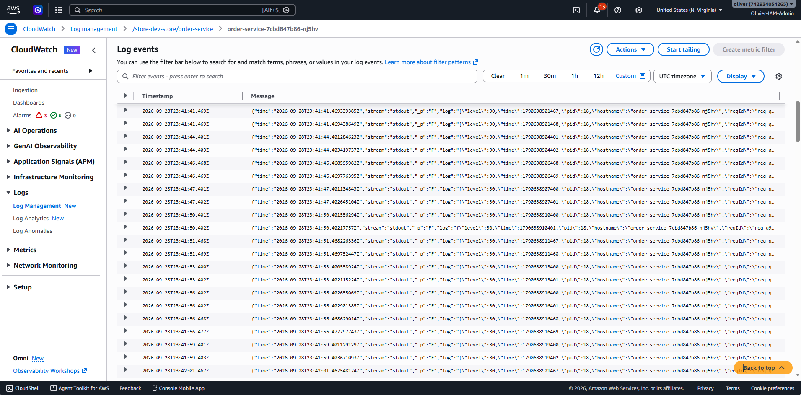 |  | 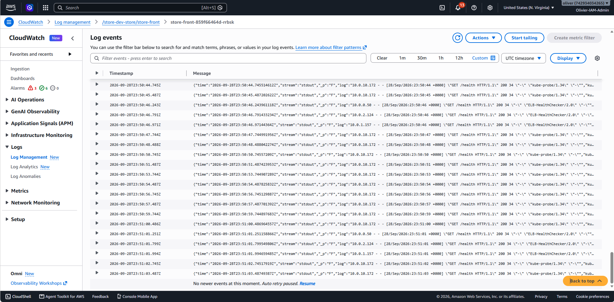 | 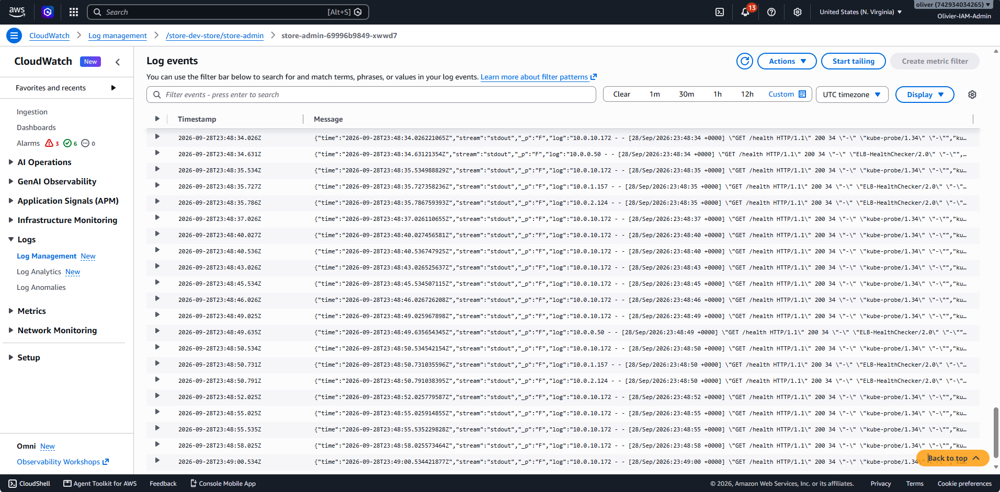 |
| order-service logs | product-service logs | store-front logs | store-admin logs |

### Traces

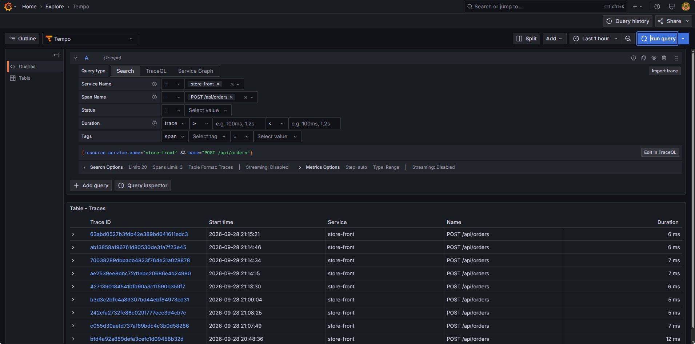

*Tempo: store-front POST /api/orders.*

| 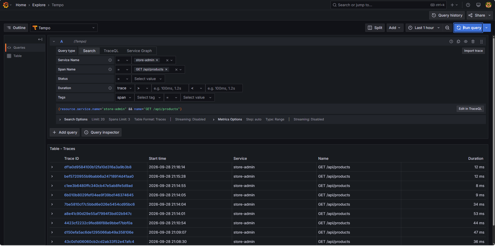 | 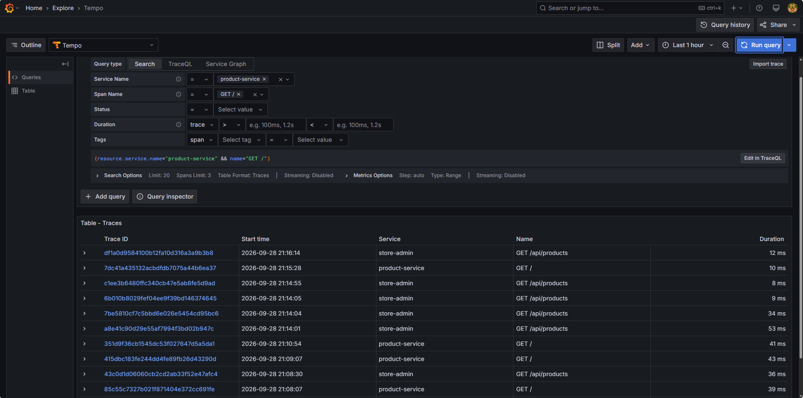 | 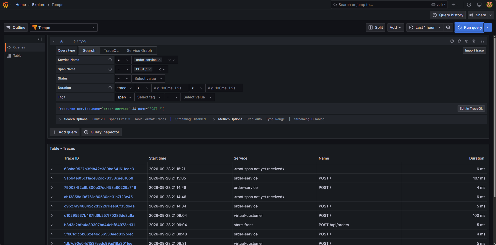 |
|:---:|:---:|:---:|
| store-admin products | product-service | order-service |
| 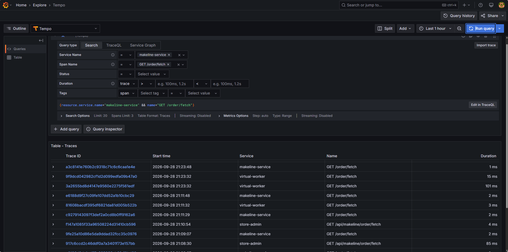 | 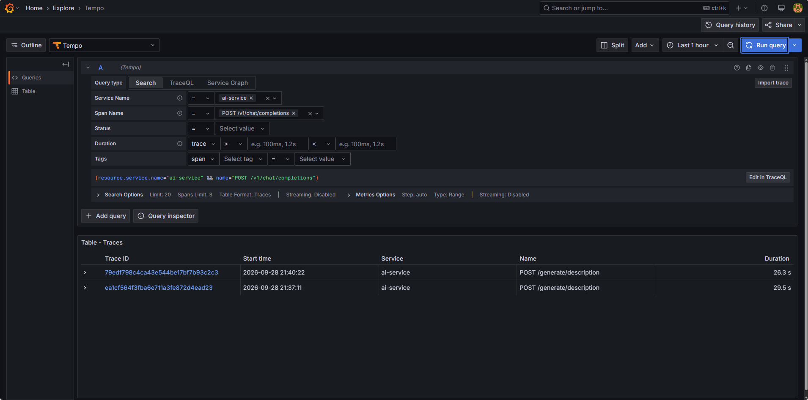 | 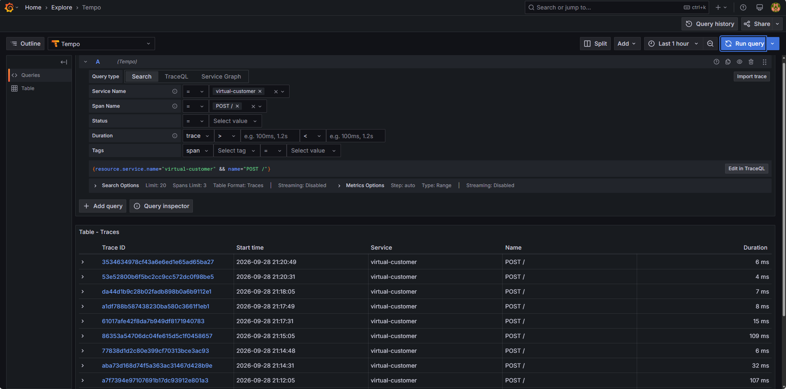 |
| Makeline fetch | ai-service description | virtual-customer |

|  |
|:---:|
| virtual-worker |

### Alerting

|  |  |
|:---:|:---:|
| Slack workspace that receives the alerts | Alertmanager posting pod, CPU, HPA, and quota alerts to Slack |

---

## Operations

Scripts apply and destroy stacks in dependency order. They are run from WSL. Passwords, personal access tokens, and API keys stay out of Git.

| Script | Purpose |
|--------|---------|
| `platform/scripts-platform/create-platform.sh` | Apply VPC through Argo CD |
| `platform/scripts-platform/check-platform.sh` | Check the cluster, nodes, and add-ons |
| `platform/scripts-platform/destroy-platform.sh` | Remove add-ons, then the cluster, then the state bucket |
| `scripts-data/create-data.sh` | ECR, Secrets Manager, DynamoDB, DocumentDB, Amazon MQ |
| `scripts-data/destroy-data.sh` | Remove ECR, Secrets Manager, DynamoDB, DocumentDB, and Amazon MQ |
| store-app `scripts-store/create-store.sh` | Repository secret, namespace, CSI classes, Argo CD applications |
| store-app `scripts-store/check-store.sh` | Check store Applications and Ingress |
| store-app `scripts-store/destroy-store.sh` | Remove the store Applications and Ingress |

Bring-up is platform, then data, then store. Teardown is the reverse. Namespace `store` has to be gone, and Karpenter nodes drained, before the cluster is destroyed.

Step-by-step notes live in the private platform repository.

Hostnames from the validated run:

| Use | Hostname |
|-----|----------|
| Storefront | `store.simsoliver.com` |
| Admin | `store-admin.simsoliver.com` |
| Grafana | `grafana.simsoliver.com` |
| Argo CD | `argocd.simsoliver.com` |

---

## Design choices

**Two repositories.** A platform change (a new add-on, a network rule) should not ride along with an application release. Argo CD should watch a repository whose job is GitOps.

**A release edits Git, and a merge deploys.** SHA builds prove an image can be produced. Only a release moves the tag that Argo CD will roll out, and a person reviews and merges that pull request.

**CI before the image.** Lint, tests, secret scanning, and SAST gate the publish. GitHub Actions never receives a kubeconfig.

**Managed nodes plus Karpenter.** The managed group is predictable capacity. Karpenter covers bursts and consolidates when the extra nodes are idle.

**Two load balancers.** Customer traffic can take a WAF rule set. Grafana and Argo CD stay off that path.

**One NAT gateway.** Enough for a single environment, and the main reason a forgotten cluster gets expensive. The destroy scripts exist so the account can go back to zero.

**One environment.** Production-shaped controls (private networking, policy, identity, WAF, audit logs) ran on `store-dev`. The account was torn down after the evidence was captured.

---

## Working with AI

|  |
|:---:|
| Cursor |

Cursor was used as a constrained assistant while building the stacks. Terraform was not applied unless asked. Every change was reviewed before apply.

Three project skills, checked in with the platform repository, were the contract for almost every change:

| Skill | Contract |
|-------|----------|
| `terraform-stack-review` | One concern per file. Keep only the resources the stack needs. Outputs are the contract between stacks. |
| `yaml-deploy-review` | Check Helm values, Argo CD, Ingress, Karpenter, and GitHub Actions for names that would break sync, image pull, or TLS. |
| `prod-k8s-security` | Check a fixed list: WAF, NetworkPolicy, Pod Identity, IMDSv2, audit logs, ResourceQuota. Add what is missing in this repository. |

The loop was to point the assistant at one stack, require it to read the skill first, review the diff, then apply and check the result in AWS, Argo CD, or Grafana. `.tfvars`, state, the OpenAI secret, the Slack webhook, and personal access tokens were not committed.

---

## Where to read the code

The layout below is the private repositories. Source is available on request.

**store-platform**

| Area | Path |
|------|------|
| Platform stacks | `platform/{backend,vpc,acm,eks,karpenter,cert_manager,metrics,monitoring,tempo,logging,otel,argocd}/` |
| ECR and GitHub OIDC | `github_actions_ecr/` |
| Secrets Manager | `secrets/` |
| Data stores | `data/{products,documentdb,mq}/` |
| Scripts | `platform/scripts-platform/`, `scripts-data/` |

**store-app**

| Area | Path |
|------|------|
| Helm chart | `helm/` |
| Per-service values | `helm-values/` |
| Argo CD | `argocd/store.yaml` |
| Ingress and policies | `k8s/ingress/store.yaml`, `k8s/policies/` |
| CI | `.github/workflows/ci-checks.yaml` |
| Image workflows | `.github/workflows/release-container-images.yaml`, `.github/workflows/package-*.yaml` |
| Services | `src/<service>/` |

---

*Oliver Sims · Store on Amazon EKS*
